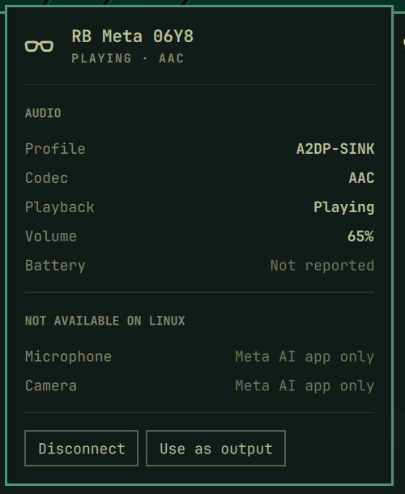

# OmetaLink



OmetaLink shows the state of Ray-Ban Meta glasses in the Omarchy bar: whether
they are connected, the Bluetooth profile and codec, whether audio is playing,
the volume, and the battery level when the system reports it. The panel can
connect or disconnect the glasses and make them the default audio output.

## Requirements

- Omarchy 4 with the shell plugin system.
- Ray-Ban Meta glasses paired with the computer (`bluetoothctl`).
- `bluetoothctl`, `pactl`, `busctl`, `dbus-monitor` and `jq`, all shipped with
  Omarchy.

## Installation

```bash
omarchy plugin add https://github.com/nestorfaeric/ometalink.git --enable
```

## Usage

- Left click: open the panel.
- Right click: connect or disconnect the glasses.
- Scroll: change the glasses volume.
- In the panel: Enter toggles the connection, `R` refreshes, Escape closes.

IPC:

```bash
omarchy-shell io.github.nestorfaeric.ometalink toggle
omarchy-shell io.github.nestorfaeric.ometalink connect
omarchy-shell io.github.nestorfaeric.ometalink disconnect
```

The same data is available from the terminal:

```bash
bin/ometalink-status | jq
bin/ometalink-ctl connect|disconnect|toggle|output|volume +5
```

Settings (`omarchy` bar widget settings):

| Key | Default | Meaning |
| --- | --- | --- |
| `address` | empty | Bluetooth address; empty detects the glasses automatically |
| `pollSeconds` | 15 | Fallback refresh; BlueZ and PipeWire events refresh immediately |
| `hideWhenDisconnected` | false | Hide the icon while the glasses are off |

## What Linux can and cannot reach

| Feature | Status | Why |
| --- | --- | --- |
| Audio output (A2DP, AAC) | Works | Standard Bluetooth audio |
| Connection, codec, playback, volume | Works | BlueZ and PipeWire |
| Microphone | Not available | The firmware drops the hands-free (HFP) link 5 ms after the handshake with the computer, every time |
| Battery | Not reported | Normally sent over HFP, or over Meta's proprietary BLE protocol |
| Camera (photo, video) | Not available | Only exposed to the Meta AI app and Meta's mobile SDK (iOS and Android) |

### Microphone diagnosis

The glasses connect to the computer's HFP gateway themselves, complete the
service-level handshake (`AT+BRSF`, `AT+BAC`, `AT+CIND`, `AT+CMER`, `AT+BIA`),
then reset the RFCOMM link. This was reproduced:

- with PipeWire's native backend, with and without mSBC;
- with the phone's Bluetooth turned off;
- with a standalone gateway reporting cellular service (`service=1`,
  `tools/hfp-probe.py`).

To retest after a firmware update, stop PipeWire from claiming the HFP gateway
role and run the probe:

```bash
echo 'monitor.bluez.properties = { bluez5.roles = [ a2dp_sink a2dp_source ] }' \
  > ~/.config/wireplumber/wireplumber.conf.d/zz-ometalink-probe.conf
systemctl --user restart wireplumber
tools/hfp-probe.py 1        # then reconnect the glasses
rm ~/.config/wireplumber/wireplumber.conf.d/zz-ometalink-probe.conf
systemctl --user restart wireplumber
```

If the log no longer shows `Connection reset by peer` after `AT+BIA`, the
microphone has become usable and OmetaLink can grow a microphone indicator.

## Development

```bash
ln -s "$PWD" ~/.config/omarchy/plugins/io.github.nestorfaeric.ometalink
omarchy plugin enable io.github.nestorfaeric.ometalink
tests/check.sh
```

Saved changes reload automatically.

## License and trademarks

MIT. Ray-Ban is a trademark of Luxottica, and Meta is a trademark of Meta
Platforms. This project is not affiliated with either.
